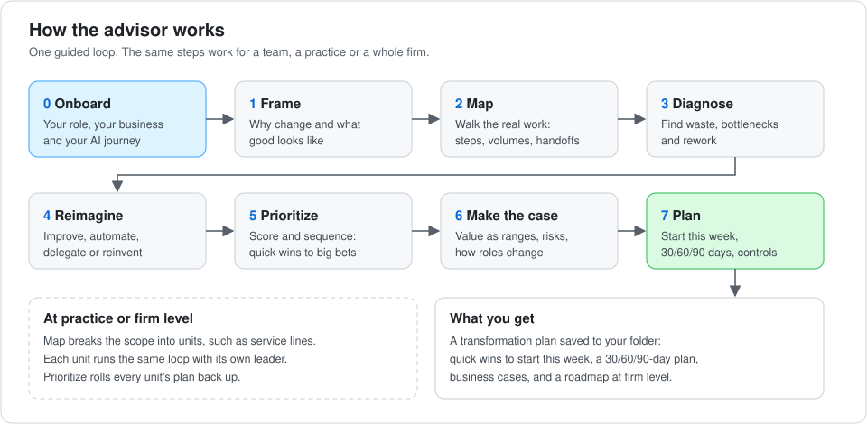
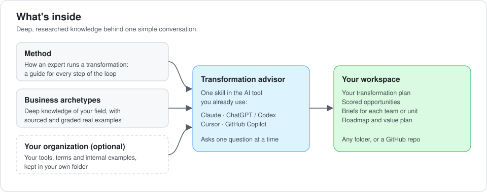

# AI Transformation Advisor

An AI advisor that guides a team lead, practice leader or head of AI through transforming how their
part of the business works with AI. It goes beyond personal productivity to redesigned workflows,
AI agents and new ways of working.

It runs as a plugin inside the AI tool you already use: Claude, ChatGPT / Codex, Cursor or GitHub
Copilot. It interviews you the way an experienced transformation lead would, draws on deep,
researched knowledge of your field, and leaves you with a transformation plan you can act on.

> **Status: in development (pre-release).** The method, three business archetypes (assurance, tax and security)
> and the installable skill are built. It installs and runs in Claude Code; the other tools are still being checked.
> See [Status](#status).

## Why

- Most people use AI for **personal tasks**, like drafting or summarizing. Few know how to redesign a
  **team's or a firm's** work around it.
- Good ideas need a **method**: where to look, how to size value, what to do first. They also need
  **real examples from your own field**, not generic ones.
- People worry that AI will replace them. The advisor is **honest** about how roles change, and it
  helps the person proposing the change lead it.

## How it works

1. **It gets to know you.** It asks about your role, what kind of business you're in, how far along
   you are with AI, and what you need from the session. Then it adapts. Someone new to AI starts
   with real examples from their field. A seasoned leader goes straight to redesign and the business
   case.
2. **It walks you through one loop**, asking one question at a time. Frame the goal, map the real
   work, find where value leaks, then reimagine it through four lenses:
   - **improve** the step
   - **automate** the flow
   - **delegate** the outcome to an AI agent
   - **reinvent** the work
3. **It works at any level.** For a team, the loop looks at specific processes. For a practice or a
   firm, it splits the work into units (such as service lines). Each unit runs the same loop, and
   the advisor rolls the results up into one roadmap.
4. **It writes things down.** Your plan is saved as you go, so you can stop, share and pick it up
   later.

More detail: [How the advisor works](docs/how-it-works.md).

## What's inside

- **Method:** how an expert runs a transformation. It draws on lean and Six Sigma,
  private-equity value-creation practice, and current evidence on what makes AI efforts succeed.
- **Business archetypes:** deep knowledge of a field. That includes how the work is done, where AI
  is really being used (with sourced, graded examples), the regulations, workforce effects and
  where the field is heading.
- **Your organization (optional):** your approved tools, terminology and internal examples. These
  stay in your own folder and never go into the plugin.

| Archetype | Status |
|---|---|
| **Assurance**: audit, SOC and attestation, sustainability assurance, assurance over AI | Ready: 10 focus areas, 206 sourced examples, all fact-checked |
| **Tax**: individual and corporate compliance, provision and Pillar Two, indirect tax, transfer pricing, controversy, research and advisory, tax data and technology | Ready: 8 focus areas, 183 sourced examples, all fact-checked. Public evidence is thinner than in audit, and the advisor says so |
| **Security**: governance and risk, security operations, threat intelligence, incident response, vulnerability and exposure, application security, cloud, identity, data security and privacy, human risk, AI security | Ready: 11 focus areas, 245 sourced examples, all fact-checked |
| **Professional services**: the base for law, consulting, accounting and advisory firms and in-house legal teams: pursuit and proposals, client development, acceptance and risk, scoping and pricing, staffing, delivery, work production, quality review, billing, knowledge management, talent and learning, firm finance | Ready: 12 focus areas, 240 sourced examples, all fact-checked. Few firms publish measured results, and the advisor says so |
| Other fields | The advisor uses its general method, and can optionally research a field on the spot |

## Getting started

### 1. Install

The plugin installs from this repository's marketplace. Pick your tool. Installation is confirmed in Claude
Code; the other tools are being checked ([checklist](docs/install-testing.md)).

| Tool | Install |
|---|---|
| Claude Code or Claude desktop (Cowork) | `/plugin marketplace add wtcooper/ai-enablement`, then install **ai-transformation**. In Cowork, use Customize > Plugins |
| Codex CLI / app or ChatGPT desktop | `codex plugin marketplace add wtcooper/ai-enablement`, then `codex plugin add ai-transformation@ai-enablement` |
| Cursor | `agent plugin marketplace add https://github.com/wtcooper/ai-enablement`, then install from `/plugins` |
| GitHub Copilot CLI | `copilot plugin marketplace add wtcooper/ai-enablement`, then `copilot plugin install ai-transformation@ai-enablement` |
| VS Code with Copilot | Add `wtcooper/ai-enablement` to the `chat.plugins.marketplaces` setting |

### 2. Start in a folder for your plan

Open your AI tool in an empty folder, or in a shared folder or repo your team uses. The advisor saves
your plan there. A [starter folder](templates/workspace/) is available if you want one, with examples of
the optional organization content.

### 3. Ask for help in your own words

> *"Help me figure out how AI could transform my audit practice."*
>
> *"I lead a tax compliance team. Where should we use AI?"*
>
> *"I'm new to AI. Show me what teams like mine are doing."*

The advisor takes it from there. A first session usually takes 60–90 minutes. Ask it to pause at
any time, and it picks up where you left off next time.

### Tips

- **Don't paste client-confidential or personal data.** Describe the work instead.
- **Share the plan.** It's plain text, so you can commit it to a repo or copy it to a shared drive.
  For a firm-wide effort, give each unit leader their brief and collect their plans.
- **Add your organization's context** (optional) in an `overlay/` folder next to your plan. It can
  hold your tool list, terms and internal examples. See
  [How the advisor works](docs/how-it-works.md#your-organizations-content).

## Status

| Done | Next |
|---|---|
| Method: 11 step-by-step guides, fact-checked | Confirm installation in Codex, Cursor and Copilot |
| Four archetypes, fact-checked: professional services (12 focus areas), assurance (10), tax (8) and security (11) | Test runs with real audit, tax and security leaders, and an eval suite |
| The advisor skill: installs and runs in Claude Code | |
| Shared library: 11 pattern guides, 10 function cards and journey stages, fact-checked | |
| Research program and quality checks | |

## Learn more

- [How the advisor works](docs/how-it-works.md): onboarding, the loop, outputs, evidence grades and
  ground rules
- [How this project is built](docs/development.md): design documents, the research program and
  repo layout

## License

[MIT](LICENSE)
